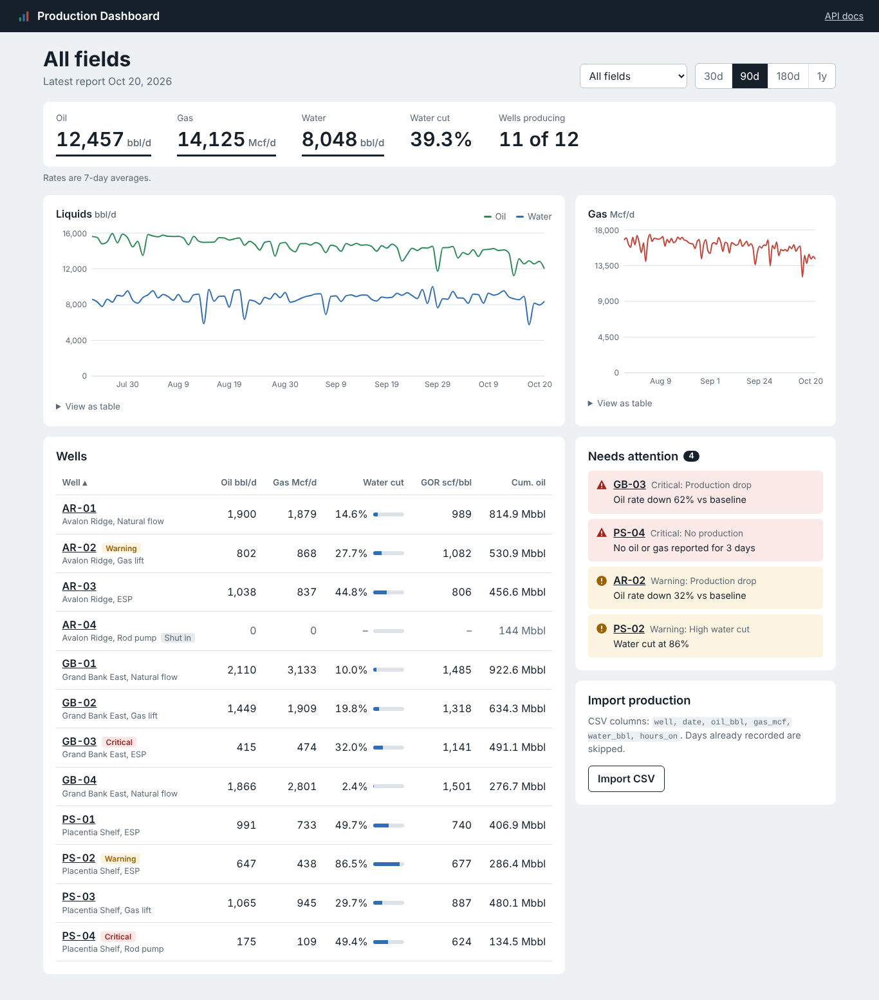
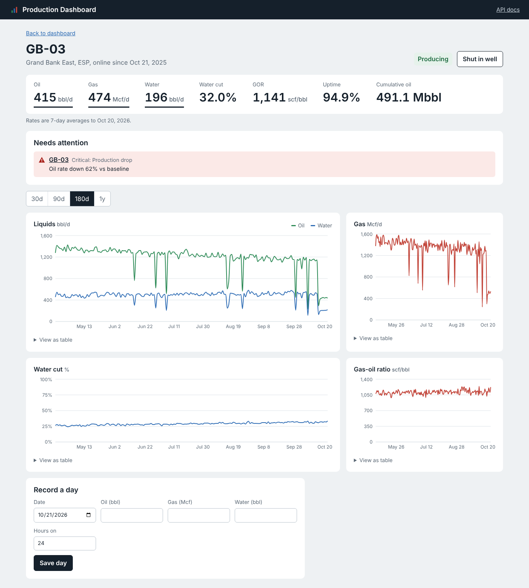

# Well Production Dashboard

[](https://github.com/Smartemmy1/well-production-dashboard/actions/workflows/ci.yml)

A full-stack web app for monitoring daily oil, gas and water production across wells and fields. It surfaces the numbers a production engineer checks every morning (rates, water cut, gas-oil ratio, uptime, cumulative oil) and flags wells that need attention.

**Stack:** Python, FastAPI, SQLAlchemy 2.0, PostgreSQL / SQLite, React 19, TypeScript, Recharts, Docker, GitHub Actions



## Features

- **Field overview:** 7-day average oil, gas and water rates, water cut and producing well count, filterable by field and time range (30 days to 1 year). Filters live in the URL, so any view can be bookmarked.
- **Production charts:** liquids (oil and water, bbl/d) and gas (Mcf/d) over time, each with a hover tooltip and a table view for accessibility.
- **Well table:** sortable by rate, water cut, GOR or cumulative oil, with alert flags inline.
- **Automatic alerts:**
  - *Production drop*: recent oil rate down 25% (warning) or 50% (critical) against the previous 30 days
  - *High water cut*: above 80%
  - *No production*: an active well reporting zero oil and gas for 3 days
- **Well detail page:** rate, water cut and GOR history, status change (producing / shut in) and a form to record a day's production.
- **CSV import:** bulk-load daily production in the format field data is usually exported in. Invalid rows are reported line by line; days already recorded are skipped, so re-uploading a file is safe.
- **Demo data:** on first start the API seeds 12 fictional wells across 3 fields with a year of production generated from Arps hyperbolic decline curves, including a few deliberate problem wells.



## Run it

### With Docker (recommended)

```bash
git clone https://github.com/Smartemmy1/well-production-dashboard.git
cd well-production-dashboard
docker compose up --build
```

- App: http://localhost:3000
- Interactive API docs: http://localhost:8000/docs

### Without Docker

Requires Python 3.13+ and Node.js 22+.

```bash
# Terminal 1: API (uses a local SQLite file)
cd backend
python -m venv .venv
source .venv/bin/activate        # Windows: .venv\Scripts\activate
pip install -r requirements-dev.txt
uvicorn app.main:app --reload

# Terminal 2: web app
cd frontend
npm install
npm run dev
```

Open http://localhost:5173. The dev server forwards `/api` calls to the API on port 8000.

To reset the demo data: `python -m app.seed` (from `backend/`).

## Tests and checks

```bash
cd backend
pytest              # 27 tests: calculations, alert rules and API endpoints
ruff check .        # lint
ruff format --check .

cd ../frontend
npm run build       # type-check and production build
```

GitHub Actions runs all of these, plus a Docker image build, on every push and pull request.

## API

| Method | Path | Purpose |
|---|---|---|
| GET | `/api/dashboard?field=&days=` | Headline rates and daily field totals |
| GET | `/api/alerts?field=` | Wells needing attention, critical first |
| GET | `/api/wells?field=&status=` | Wells with recent rates, water cut, GOR, cumulative oil |
| GET | `/api/wells/fields` | Field names |
| POST | `/api/wells` | Create a well |
| GET / PATCH / DELETE | `/api/wells/{id}` | Read, update or delete a well |
| GET | `/api/wells/{id}/production?start=&end=` | Daily production with water cut and GOR |
| POST | `/api/wells/{id}/production` | Record one day |
| POST | `/api/production/upload` | Import a CSV file |

Full request and response schemas are at `/docs` when the API is running.

### CSV format

```csv
well,date,oil_bbl,gas_mcf,water_bbl,hours_on
AR-01,2026-10-21,1850,1610,320,24
GB-03,2026-10-21,410,470,190,22.5
```

`hours_on` is optional and defaults to 24.

## Project structure

```
backend/
  app/
    main.py              FastAPI app, startup, CORS
    config.py            Settings and alert thresholds (environment variables)
    database.py          Engine and per-request session
    models.py            Well and ProductionRecord tables
    schemas.py           Request/response validation (Pydantic)
    routers/             wells, production (CSV import), dashboard and alerts
    services/analytics.py  Water cut, GOR, rate averaging, alert rules
    seed.py              Demo data from Arps decline curves
  tests/                 pytest suite (in-memory SQLite)
frontend/
  src/
    pages/               Dashboard, WellDetail
    components/          RateChart, WellTable, AlertList, CsvUpload, ProductionForm, Figures
    api.ts               Typed API client
docker-compose.yml       PostgreSQL + API + web app
.github/workflows/ci.yml Lint, test, build
```

## Configuration

Set as environment variables or in `backend/.env` (see `.env.example`):

| Variable | Default | Meaning |
|---|---|---|
| `DATABASE_URL` | `sqlite:///./production.db` | Any SQLAlchemy URL; Docker uses PostgreSQL |
| `SEED_DEMO_DATA` | `true` | Seed demo wells when the database is empty |
| `DROP_WARNING_PCT` / `DROP_CRITICAL_PCT` | `25` / `50` | Production drop alert thresholds |
| `HIGH_WATER_CUT` | `0.80` | Water cut alert threshold |

## Possible next steps

- Alembic migrations instead of creating tables at startup
- User accounts and per-field access
- Decline curve fitting and production forecasts per well
- Scheduled email or Slack summaries of new alerts

## License

MIT. Field and well names in the demo data are fictional.
